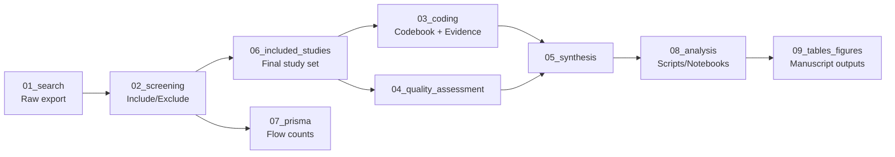

# SLR Cloud — Multi-Cloud Governance Evidence Repository

This repository is the evidence package accompanying the following research contribution:

## Publication

**Sabazadeh, S. and Lu, T. (2026).** *Cybersecurity Governance in Multi-Cloud Environments: A Systematic Review and Cross-Framework Gap Analysis.* IEEE 2026 International Conference on Emerging Trends in Engineering and Computing (ETECOM), Paris, France, 26–27 October 2026. **Accepted.**

```bibtex
@inproceedings{sabazadeh_lu_2026_multicloud,
  author    = {Sabazadeh, Sara and Lu, Tianxiang},
  title     = {Cybersecurity Governance in Multi-Cloud Environments: A Systematic Review and Cross-Framework Gap Analysis},
  booktitle = {IEEE 2026 International Conference on Emerging Trends in Engineering and Computing (ETECOM)},
  year      = {2026},
  address   = {Paris, France},
  month     = oct,
  note      = {Accepted, 26--27 October 2026}
}
```
## Purpose

This repository contains the systematic literature review evidence supporting the paper on **cybersecurity governance in multi-cloud environments**. It consolidates the search records, screening decisions, quality appraisal, coding evidence, synthesis outputs, and derived figures used in the study.

The repository is designed to support **auditability, reproducibility, and traceability** of the review findings. It preserves the evidence chain from candidate studies through screening and coding to the synthesized cross-framework gap analysis.

An independent researcher or reviewer can use the repository to verify:

1. The search strategy and database exports used to identify candidate studies.
2. Screening decisions and the associated inclusion/exclusion reasons.
3. Coding decisions for the included studies, together with supporting source evidence.
4. Quality-assessment results used in the review.
5. The comparative coverage matrix, governance gap taxonomy, and synthesis outputs underlying the paper's findings.

## Directory Structure

| Directory                                                 | Contents                                                                     | Raw / Derived                              |
| --------------------------------------------------------- | ---------------------------------------------------------------------------- | ------------------------------------------ |
| [01_search/](01_search/README.md)                         | Search strategy, search history log, raw database export(s)                  | **Raw / source**                           |
| [02_screening/](02_screening/README.md)                   | Title/abstract and full-text screening decisions, exclusion reasons          | Derived from search results                |
| [03_coding/](03_coding/README.md)                         | Codebook, coding scheme, and applied evidence per included study             | Derived from included studies              |
| [04_quality_assessment/](04_quality_assessment/README.md) | Study quality and rigor appraisal records                                    | Derived from included studies              |
| [05_synthesis/](05_synthesis/README.md)                   | Comparative coverage matrix, governance gap taxonomy, synthesis notes        | Derived from coding evidence               |
| [06_included_studies/](06_included_studies/README.md)     | Final included study set and bibliographic summaries                         | Derived (filtered) from search + screening |
| [07_prisma/](07_prisma/README.md)                         | PRISMA flow counts at each stage                                             | Derived (aggregated) from all stages       |
| [08_analysis/](08_analysis/README.md)                     | Scripts/notebooks used to transform raw/coded inputs into tables and figures | Analysis code (not data)                   |
| [09_tables_figures/](09_tables_figures/README.md)         | Source data and generated manuscript-ready outputs                           | Derived outputs                            |
| [docs/](docs/reproducibility.md)                          | Reproducibility workflow, data availability, and archival notes              | Documentation                              |

## Research Workflow and Evidence Trail



1. **Search** — Candidate studies are identified and documented using the search strategy and raw exports retained in [01_search/](01_search/README.md).
2. **Screening** — Each record is assessed for inclusion or exclusion in [02_screening/](02_screening/README.md), with reasons recorded according to the established exclusion scheme.
3. **Coding** — Included studies are coded against the review schema in [03_coding/](03_coding/README.md), with decisions supported by evidence from the source publications.
4. **Quality Assessment** — Included studies are evaluated in [04_quality_assessment/](04_quality_assessment/README.md) to support study appraisal and synthesis.
5. **Synthesis** — The coded evidence and quality appraisal are combined in [05_synthesis/](05_synthesis/README.md) into comparative findings and cross-framework governance gap analysis.
6. **PRISMA reporting** — PRISMA counts are documented in [07_prisma/](07_prisma/README.md) to describe the review flow.
7. **Analysis & outputs** — Processing scripts and notebooks in [08_analysis/](08_analysis/README.md) generate the tables and figures in [09_tables_figures/](09_tables_figures/README.md).

See [docs/reproducibility.md](docs/reproducibility.md) for workflow details and [docs/data_availability.md](docs/data_availability.md) for the repository's archival and data-sharing statement.

## Raw vs. Derived Data at a Glance

* **Raw / source data:** search exports, bibliographic records, and source evidence retained in [01_search/](01_search/README.md)
* **Screening decisions:** records in [02_screening/](02_screening/README.md)
* **Coding scheme + evidence:** primary research artifacts in [03_coding/](03_coding/README.md)
* **Quality appraisal:** records in [04_quality_assessment/](04_quality_assessment/README.md)
* **Synthesis outputs:** comparative and gap-oriented materials in [05_synthesis/](05_synthesis/README.md)
* **Final included-study bibliography:** included study set in [06_included_studies/](06_included_studies/README.md)
* **PRISMA reporting counts:** results in [07_prisma/](07_prisma/README.md)
* **Analysis code:** scripts and notebooks in [08_analysis/](08_analysis/README.md)
* **Manuscript-ready outputs:** tables and figures in [09_tables_figures/](09_tables_figures/README.md)

## License

See [LICENSE](LICENSE).

## Evidence Integrity and Future Extension

This repository serves as the archival evidence base for the accepted ETECOM 2026 paper and should be treated as a **research record rather than a generic template**.

To preserve the integrity of the evidence base:

1. Keep the research artifacts and schema stable so that the evidence chain remains auditable.
2. Preserve the distinction between raw search evidence, screening records, coding evidence, and derived synthesis outputs.
3. When extending the review for a future journal publication or follow-up study, add new evidence and analyses without overwriting the sourced records used for the current paper.
4. Update folder-level documentation whenever the schema or evidence structure changes, so that the repository remains transparent and reproducible.
