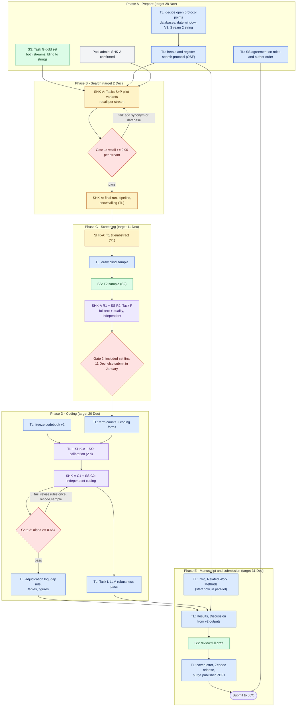

# Multi-Cloud Governance Review — Journal Extension (v2): Working Instructions

This folder holds everything needed to run the **second, extended round** of
our systematic literature review on cybersecurity governance in multi-cloud
environments. The first round was published at ETECOM 2026; its evidence is in
the top-level folders of this repository and **must not be changed**.

You will find your tasks below by role. Read sections 1–3 first. Then go to
the section for your role. Each task names the exact files to read, the
commands to run and the files to deliver.

**Project lead and contact for all questions:** Prof. Dr. Tianxiang Lu,
IU International University of Applied Sciences — tianxiang.lu@iu.org.
If something in these instructions is unclear or does not work, stop and
ask. Do not improvise around the protocol.

---

## 0. Project plan: order and dependencies

The arrows are fixed: a step starts only when every step pointing to it is
done. The dates are targets and may move; if a gate fails, everything after it
moves, not just the gate. Colours: blue = TL, green = SS, amber = SHK-A,
purple = SHK-A and SS together (independently), grey = external, red = gate.



Critical path: gold set and protocol freeze -> pilot -> screening -> full text
-> coding -> results -> review -> submission. Steps TL can do off the critical
path: decide the open protocol points and freeze the codebook (both before
coding), draft Intro, Related Work and Methods, and settle authorship.

## 1. Roles

| Role | Who | Tasks in this README |
|---|---|---|
| **Lead (TL)** | Prof. Dr. Tianxiang Lu | First and corresponding author. Owns the protocol and codebook; decides open questions; approves the gold set; draws the second-screener sample; issues coding forms and term counts; **adjudicates** screening, full-text and coding disagreements (does not code) |
| **Co-author (SS)** | Sahel Sabazadeh | Task G (gold set), Task T2 as screener **S2**, Task F as reviewer **R2**, Task C as coder **C2**, Task W (manuscript review) |
| **SHK-A** | Student assistant A | Task S (search), Task P (processing), Task T1 as screener **S1**, Task F as reviewer **R1**, Task C as coder **C1** |

**Coders and adjudication.** SHK-A (C1) and SS (C2) code independently and
blind to each other; TL adjudicates as a non-coder. Every resolution is logged
in `v2/coding/adjudication_log.csv`
(`cell_id, C1, C2, final, rule_applied, resolved_by, note`).

**SS's v1 exposure.** SS produced the v1 coding. This does not inflate
agreement (α is computed against SHK-A, who has not seen v1), but it could carry
v1 judgements into v2. Safeguards:
1. SS codes from the frozen codebook and the PDFs only, without opening the v1
   workbook, `03_coding/`, `05_synthesis/`, `docs/known_issues.md` or the
   ETECOM tables (ground rule 4).
2. Every rating needs a quote with PDF page or a logged term search (codebook §6),
   so carried-over judgements are auditable.
3. Pre-specified anchoring check: TL tabulates SS's v2 ratings against the v1
   ratings for the same cells and compares this with SHK-A's ratings. A
   markedly closer fit for SS than for SHK-A is reported as possible
   anchoring.
4. The paper states SS's v1 exposure as a limitation.

**LLM robustness pass (Task L).** An LLM codes all cells once, as a
sensitivity check. It does not count as a coder, does not enter α, and does not
influence adjudication. Nobody looks at its output before both human forms are
with TL.

**Library access:** SS and SHK-A both have EBSCO access (Tasks S and P).
Tasks F and C need the licensed full-text PDFs (ground rule 6).

Estimated effort:

| Task | Who | Hours |
|---|---|---|
| Setup (section 3) | SS, SHK-A | 1 each |
| G: gold set | SS | 5 |
| S + P: search runs and processing | SHK-A | 5 |
| T1: first title/abstract screening | SHK-A | 6–14 (depends on the final record count) |
| T2: second screening (sample) | SS | 4–6 |
| F: full-text eligibility + quality scores | SHK-A (R1), SS (R2); TL adjudicates | 3–5 each |
| C: coding (incl. 2 h calibration) | SHK-A (C1), SS (C2); TL adjudicates | about 20 each |
| L: LLM robustness pass | TL (run), Claude via API | 2 |
| W: manuscript | TL drafts; SS reviews (author work, not SHK hours) | — |

Target dates: see the plan in section 0.

## 2. Ground rules (apply to everyone)

1. **Follow the protocol documents exactly.**
   - Search: `v2/protocol/search_protocol_v2.md`
   - Coding: `v2/protocol/codebook_v2.md`

   If a rule does not fit a case, record the case in the notes column and ask TL.
2. **Never edit or delete** anything outside `v2/`. Within `v2/`, never edit:
   - `protocol/` (owned by TL);
   - existing files in `runs/` (each run is an evidence record).
3. **Work independently where told to.** Screeners and coders do not discuss
   individual decisions with each other until TL has collected both results.
4. **Coders work blind.** During coding, do not open any of these:
   - the top-level folders `03_coding/`, `05_synthesis/`, `docs/known_issues.md`;
   - the ETECOM paper's tables;
   - the other coder's form.

   This applies to SS as well, although she produced the v1 coding (see the
   safeguards in section 1). Nobody opens any LLM output (Task L) before both
   coding forms are with TL.
5. **Log everything.** The pipeline logs automatically. Manual steps are logged
   in the files named in each task.
6. **Do not share full-text PDFs** outside the project. Many are licensed to
   IU only.

## 3. Setup (once)

You need Python 3.10 or newer (required by ASReview LAB 3), Git, and a GitHub account. Send your GitHub user
name to TL to get access to the repository `Prof-it/slr-cloud`. Coders who
only do Task C do not need the repository (see Task C).

```bash
git clone https://github.com/Prof-it/slr-cloud.git
cd slr-cloud
python3 -m venv .venv
source .venv/bin/activate            # Windows: .venv\Scripts\activate
pip install -r 08_analysis/requirements.txt
python v2/pipeline/slr_pipeline.py -h   # should list ingest, dedup, filter, ...
```

Work on your own branch and never on `main`:

```bash
git checkout -b shk-<your initials>      # e.g. shk-mk
```

Every time you start working, run `source .venv/bin/activate` again in the
repository folder.

**Naming rules used throughout:**
- **Run ID:** `<date>_EBSCO_<variant>`, with the date as YYYY-MM-DD and the variant from protocol §3 (`V1`, `V1b`, `V2`, `V3`). Example: `2026-11-16_EBSCO_V2`.
- **Screener and coder IDs:** `S1` (SHK-A), `S2` (SS), `R1`/`R2` (SHK-A/SS), `C1` (SHK-A), `C2` (SS).

---

## Task G — Build the gold set (SS)

**Read first:** the eligibility criteria in Task T1, step 3, and
`v2/protocol/search_protocol_v2.md` §4 (recall validation) only. Do this
**before** any search variant is run. Do not read protocol §§2–3, which contain
the search strings: the gold set must be independent of them.

The scope covers two streams (protocol §2a, Option 2, agreed): **Stream 1**,
multi-cloud governance studies, and **Stream 2**, comparisons of cloud security
or governance frameworks (e.g. ISO/IEC 27001, NIST CSF, CSA CCM) even without a
multi-cloud focus. The gold set needs papers from both, because recall is
reported per stream.

1. From the reference lists of Diningrat et al. 2025, Ali et al. 2025 and
   Alouffi et al. 2021, collect primary studies published from 2020 onwards
   that meet the Task T1 inclusion criteria.
2. Scan the 2020–2026 issues and proceedings of Journal of Cloud Computing,
   IEEE CLOUD and Computers & Security for papers of either stream that
   meet the same criteria.
3. Add each paper as a row in `v2/search/gold_candidates.csv` with the columns
   of `protocol/gold_set.csv`: `doi`, `title`, `year`, `gold_source` (for
   example "cited in Ali 2025" or "JCC scan"), and in `notes` the stream:
   `S1` (multi-cloud) or `S2` (framework comparison).
4. Target: 15–25 papers in total, including the existing 10, with at least
   5 per stream (the existing 10 contain about 6 for Stream 1 and 3–4 for
   Stream 2). Commit and open a
   pull request "Gold set candidates". TL reviews the list and copies the
   accepted rows into `protocol/gold_set.csv`.

## Task S — Run a search variant (SHK-A)

**Read first:** `v2/protocol/search_protocol_v2.md`, §§1–3.

1. Log in to EBSCO through the IU library portal.
2. Open the advanced search and enter the string of the variant TL assigned,
   **exactly** as written in protocol §3.
   - If the interface rejects the syntax (for example the proximity operator
     `N10`), do not rewrite the string yourself. Send TL a screenshot of the
     error message.
3. Set the filters from protocol §1:
   - peer-reviewed;
   - English;
   - publication date as stated in `v2/pipeline/filter_rules.json`
     (`F-YEAR`, `min` to `max`);
   - document types: academic journals and conference papers.
4. Note the number of results shown.
5. Export **all** results as **CSV**. If EBSCO limits the export size, export
   in consecutive batches until all results are exported, and keep every file.
6. Save the export(s) as `v2/search/exports/<run ID>.csv`. For batches, name
   them `<run ID>_part1.csv`, `<run ID>_part2.csv`, …
7. Add one row to `v2/protocol/search_iterations.csv`. This is the only file in
   `protocol/` you may edit. Fill in:
   - `run_id`, `date`, and `interface` (EBSCO Research);
   - `variant`;
   - `exact_string`: copy it from the search history in EBSCO, not from this README;
   - `filters`;
   - `hits`: the number from step 4.

   Leave the other columns empty; they are filled in by Task P.

## Task P — Process a run with the pipeline (SHK-A)

From the repository folder, with `.venv` active. Replace `<run ID>` with your
run ID throughout:

```bash
P=v2/pipeline/slr_pipeline.py
RUN=v2/runs/<run ID>
python $P ingest --run $RUN --db EBSCO v2/search/exports/<run ID>*.csv
python $P dedup  --run $RUN
python $P filter --run $RUN --config v2/pipeline/filter_rules.json
python $P recall --run $RUN --gold v2/protocol/gold_set.csv
python $P export --run $RUN
python $P prisma --run $RUN
```

Then:

1. Complete the row in `search_iterations.csv` from the `prisma` output.
   - `after_dedup` is records out of `dedup`.
   - `after_rules` is "Records to screen".
   - `gold_found`, `gold_total` and `recall` come from the gold-set recall line.
2. Open `$RUN/04_recall_report.csv`. For every gold paper marked `N`, search
   its title in EBSCO and note in the `notes` column why it was missed. Typical
   reasons:
   - not indexed;
   - indexed, but the title/abstract lacks a facet term (name the term);
   - removed by a filter.
3. Commit and push. Then open a pull request titled "Search run <run ID>" and
   assign TL:

   ```bash
   git add v2/search/exports v2/runs/<run ID> v2/protocol/search_iterations.csv
   git commit -m "Search run <run ID>"
   git push -u origin shk-<your initials>
   ```

TL decides which variant becomes the final search (protocol §4). **Do not
start Task T1 before TL has confirmed the final run in writing.**

## Task T1 — First screening of titles and abstracts (SHK-A, screener S1)

**Input:** `v2/runs/<final run ID>/05_screening.csv`

**Tool: ASReview LAB** (version 3.x). Install it once in your `.venv` with
`pip install asreview`, check with `asreview --version`, then start it with
`asreview lab`; it opens in your browser. Everything runs locally on your
computer; no data is uploaded.

1. Create a new project in the screening (oracle) mode and import
   `05_screening.csv` as the dataset.
2. If ASReview asks for prior knowledge, use the random option. Label records
   until it has at least one relevant and one irrelevant record.
3. Screen with the eligibility criteria below. Decide on title and abstract
   only.

   **Include (relevant)** if *all* hold:
   - peer-reviewed research (journal article or conference paper);
   - it concerns the security **governance** of cloud environments, that is,
     at least one of: governance structure, policy definition/enforcement,
     shared responsibility, risk posture/security monitoring, identity
     federation (codebook §3);
   - it addresses **two or more cloud providers** (multi-cloud, cross-cloud,
     cloud federation). **Also include** (protocol §2a, Option 2) studies that compare cloud security frameworks or
     standards (e.g. ISO/IEC 27001, NIST CSF, CSA CCM), even without a
     multi-cloud focus.

   **Exclude** if any of these applies:
   - a purely technical contribution (cryptographic scheme, scheduling,
     performance, cost optimisation) without any governance element;
   - single-cloud only;
   - not research (editorial, tutorial, product description).

   **If in doubt, include.** Unclear cases are resolved at full-text stage.
4. Before you start, open **Dashboard → Set threshold** and set it to **100**.
   **Stop** when *both* of these hold, then click **In review → Mark as
   finished**, and write down the numbers on the dashboard at that moment:
   - you have screened at least 50% of all records;
   - your last 100 consecutive decisions were all *irrelevant*.
5. Export: open the project, go to **Collection → Export**, select **all
   records** and choose **CSV**. The export keeps the `record_id` column and
   adds `asreview_label` (1 = relevant, 0 = irrelevant, empty = not screened).
   Check that both columns are present. Save it as
   `v2/screening/<final run ID>_S1.csv`.
6. Create `v2/screening/<final run ID>_S1_notes.md` containing:
   - start and end date;
   - ASReview version (`asreview --version`);
   - number screened, number relevant, and the length of the final run of
     irrelevant decisions;
   - any records you were unsure about (record_id + one sentence).
7. Commit both files on your branch and open a pull request
   "Screening S1 <final run ID>".

## Task T2 — Second screening of a sample (SS, screener S2)

TL creates your sample from S1's results. Do not look at S1's file:

```bash
# run by TL only
python v2/pipeline/slr_pipeline.py sample --run v2/runs/<final run ID> \
  --screener1 v2/screening/<final run ID>_S1.csv \
  --out v2/screening/<final run ID>_S2_sample.csv
```

You receive `<final run ID>_S2_sample.csv`. Its records come in random order.
It contains all of S1's inclusions plus a random 10% of S1's exclusions and of
the records S1 did not screen. You are not told which is which.

1. Open the file in a spreadsheet program. For each row:
   - enter `include` or `exclude` in the `decision` column, using the
     criteria in Task T1, step 3;
   - for `exclude`, enter in `reason` one of: `not-multicloud`,
     `no-governance`, `technical-only`, `not-research`, `other: <short text>`.
2. Do not add, remove or reorder rows. Save as CSV (UTF-8), named
   `v2/screening/<final run ID>_S2.csv`.
3. Commit it on your branch and open a pull request
   "Screening S2 <final run ID>".

TL then compares S1 and S2 and resolves disagreements. You may be asked to
explain individual decisions.

---

## Task C — Coding of the included studies (coders C1 and C2)

**Read first, completely:** `v2/protocol/codebook_v2.md`. TL tells you which
version is frozen; code only with that version.

**You receive from TL**, in the IU OneDrive folder TL shares with you:
- the frozen `codebook_v2.md`;
- the full-text PDFs of the included studies;
- your personal coding form `form_<your coder ID>.xlsx`.

You do **not** need the repository for this task.

**Calibration (about 2 h, together with TL and the other coder).** Two
sources are coded jointly to align your understanding of the rules. These
cells do not count towards agreement. After calibration you code alone.

**Independent coding.** In your form:

1. **Sheet `Sources`:** for each study, choose `S_scope`, `T_type`,
   `N_normativity` and `E_evidence_basis` from the dropdowns (codebook §7).
2. **Sheet `Cells`:** one row per study × dimension (D2–D6). For each row:
   - **`G` and `M`:** choose from the dropdowns. Rate them independently
     (codebook §4); apply the decision rules in §4.3.
   - **`aspects`:** enter the codes that apply, comma-separated, chosen only
     from `allowed_aspects` in the same row (codebook §5). For `*-other`, add
     a short label, e.g. `D5-other: incident response`.
   - **`quote`, `pdf_page`, `section`:** required for G2/G3 and M2/M3. Use a
     verbatim quote of at most 50 words. The page is the **PDF page number**
     shown by your PDF viewer, not the page number printed on the paper.
   - **`term_search_terms`, `term_search_hits`:** required for G1 and M1
     (codebook §6). TL gives both coders `term_counts_by_cell.csv`, which
     lists the hits and PDF pages for every term. Open the listed pages,
     check the hits, and copy the terms and the number of hits you checked
     into the two columns. The counts tell you where to look; the rating is
     still your judgement.
   - **`rule_applied`:** the rule ID(s) you relied on, e.g. `R-M2a`.
   - **`rationale`:** one or two sentences.
   - **`status`:** `final`, or `unresolved` if you cannot decide. Explain
     why in the rationale; do not guess.
3. Do not change the sheet structure, column order, cell IDs or dropdown values.
4. Save regularly. When finished, upload the form to the same OneDrive folder
   as `form_<your coder ID>_done.xlsx` and email TL.

**Blindness:** do not discuss individual ratings with the other coder before
TL confirms receipt of both forms. Do not look at the earlier (v1) coding
(ground rule 4).

---

## Task F — Full-text eligibility and quality scores (R1 = SHK-A, R2 = SS)

R1 and R2 decide every full text independently, including the v1 studies;
TL adjudicates. SS judges the v1 studies from the full text and the criteria,
not from her v1 decisions.

For each record, enter in `v2/screening/<final run ID>_FT_<your ID>.csv`:
`record_id`, `decision` (include / exclude), `reason` (codes as in Task T2),
and the five quality scores Q1–Q5 (0–2 each, rubric in the paper's Table 4,
threshold 6/10). Decide on the full text; do not discuss with the other
reviewer until TL has both files. TL logs every disagreement and its
resolution.

## Task W — Manuscript (TL drafts, SS reviews)

TL redrafts the manuscript from the v2 outputs, building on SS's earlier draft
(passages from the ETECOM 2026 paper are rewritten, because the IEEE text and
figures cannot appear verbatim in the open-access article). SS reviews the
full draft around 22–28 December and approves the final version.

## Task L — LLM robustness pass (TL)

Run only after the codebook is frozen and both human forms are with TL.

1. Script, prompt and model are fixed before the run: the frozen
   `codebook_v2.md` is the instruction, each full-text PDF is the input, and
   the output is one row per cell in the coding-form columns (G, M, aspects,
   quote, pdf_page, rule_applied, rationale). Temperature 0; record the exact
   model ID and the date.
2. Archive the prompt, the raw responses and the parsed table in
   `v2/coding/llm/` (PDFs stay out of git).
3. Compare the LLM table with the **adjudicated** human result: per-scale
   agreement (α, AC1) and a list of cells where they differ. TL checks a sample
   of LLM quotes against the PDFs and reports quote accuracy.
4. In the paper this is a sensitivity analysis only. No human rating is
   changed because of it. Disclose it in the AI-use statement.

## 4. Reference: what the pipeline does

| Command | Input | Output in the run folder | Purpose |
|---|---|---|---|
| `ingest` | EBSCO CSV, RIS or BibTeX exports | `01_records_ingested.csv` | One common record format |
| `dedup` | ingested records | `02_records_deduplicated.csv`, `02_duplicate_pairs.csv` | Merges records with the same DOI, the same title + year (±1), or near-identical titles (≥ 0.95 similarity). Same title with different DOIs is logged but not merged. |
| `filter` | deduplicated records + `filter_rules.json` | `03_records_eligible_for_screening.csv`, `03_excluded_by_rule.csv` | Excludes by year, document type, language, retraction, missing title; every exclusion is listed with its rule ID |
| `recall` | eligible records + `gold_set.csv` | `04_recall_report.csv` | Share of known relevant papers the search found |
| `export` | eligible records | `05_screening.csv`, `05_screening.ris` | Input for screening |
| `prisma` | `run_log.jsonl` | printed counts | Numbers for the PRISMA flow diagram |
| `sample` | screener-1 decisions | blind sample + separate answer key | Second screening (TL) |
| `snowball` | DOIs of included studies | `snowball_<direction>.csv` | Backward/forward citations via OpenAlex (TL) |
| `openalex-search` | query string | `openalex_search.csv` | Recall cross-check (TL) |
| `coding-form` | list of included studies | `form_<coder>.xlsx` | Blank coding form per coder (TL) |
| `term_counts.py` (separate script) | folder of included full-text PDFs | `term_counts.csv`, `term_counts_by_cell.csv` | Hits and PDF pages for the codebook §6 term lists, per study and dimension; given to both coders for G1/M1 (TL) |

Every command appends one line to `run_log.jsonl` in the run folder. Do not
edit or delete this file.

## 5. Troubleshooting

| Problem | Fix |
|---|---|
| `ModuleNotFoundError: No module named 'openpyxl'` | The virtual environment is not active. Run `source .venv/bin/activate` in the repository folder. |
| `command not found: python` | Use `python3` instead of `python`. |
| `ingest` reports `missing_title` > 0 | The export file is incomplete or in another format. Re-export as CSV and tell TL which export option you used. |
| `dedup` or `filter` says a file is missing | Run the commands in the order of Task P, with the same `--run` folder. |
| You ran a command with a wrong option | Do not delete or edit files. Tell TL which command you ran; TL decides whether to start a new run folder. |
| OpenAlex commands fail with a network error | Set your e-mail for OpenAlex (`export OPENALEX_MAILTO=<your IU e-mail>`) and retry. If it still fails, report it; only TL runs these commands. |
| Excel changes the CSV (dates, special characters) | Save with "CSV UTF-8". Do not open and re-save pipeline output files; only the screening and coding files are edited by hand. |
